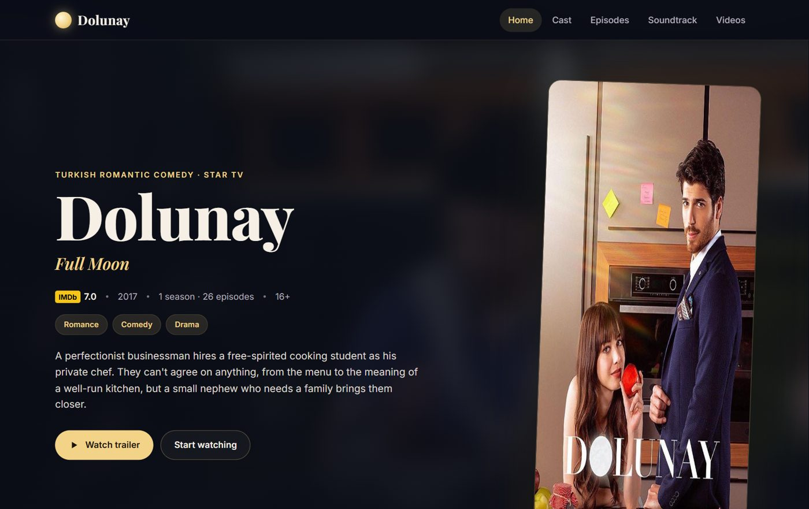
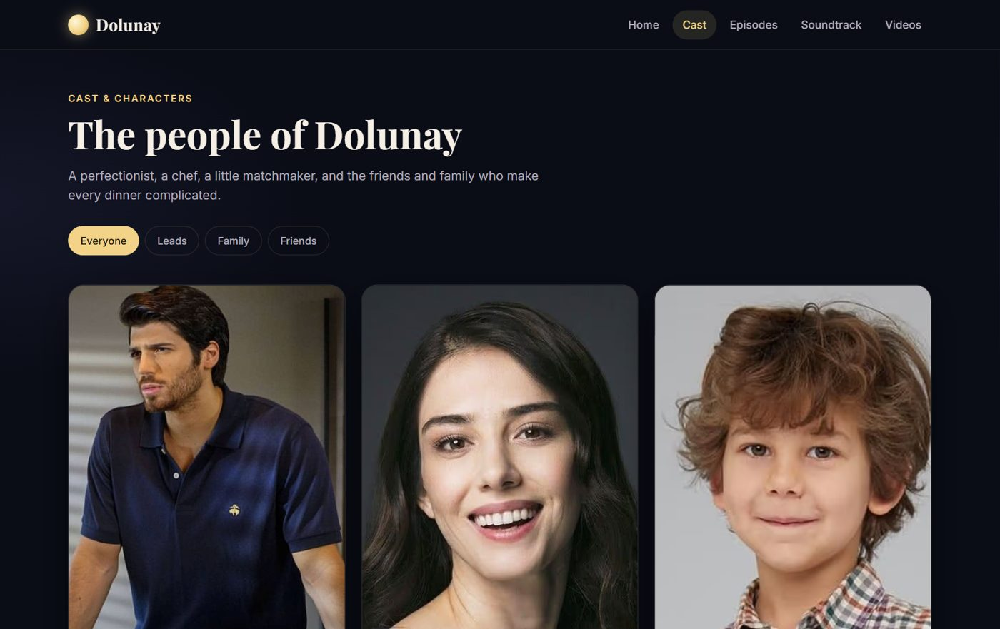
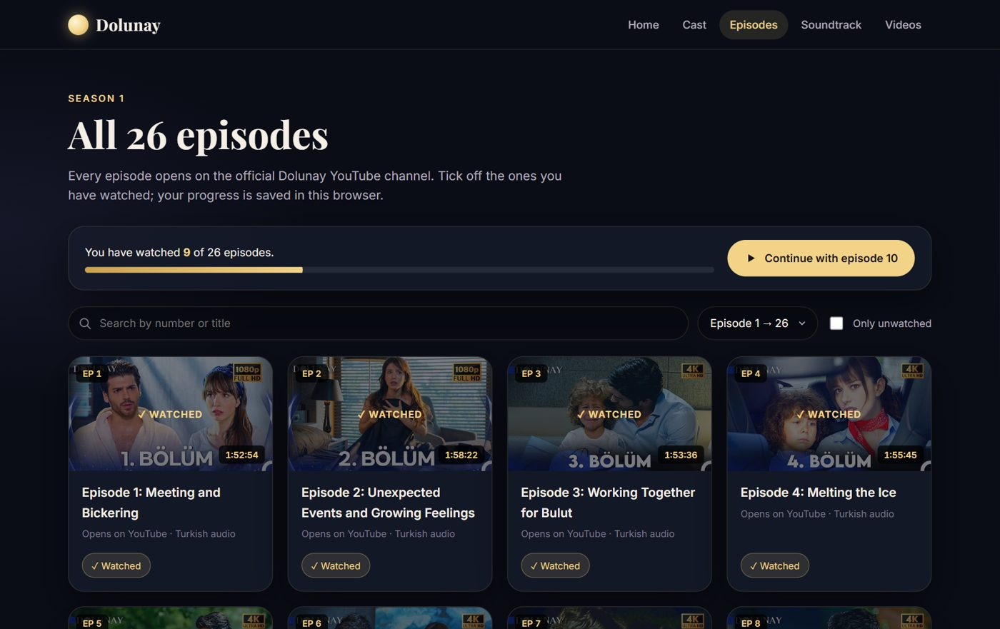
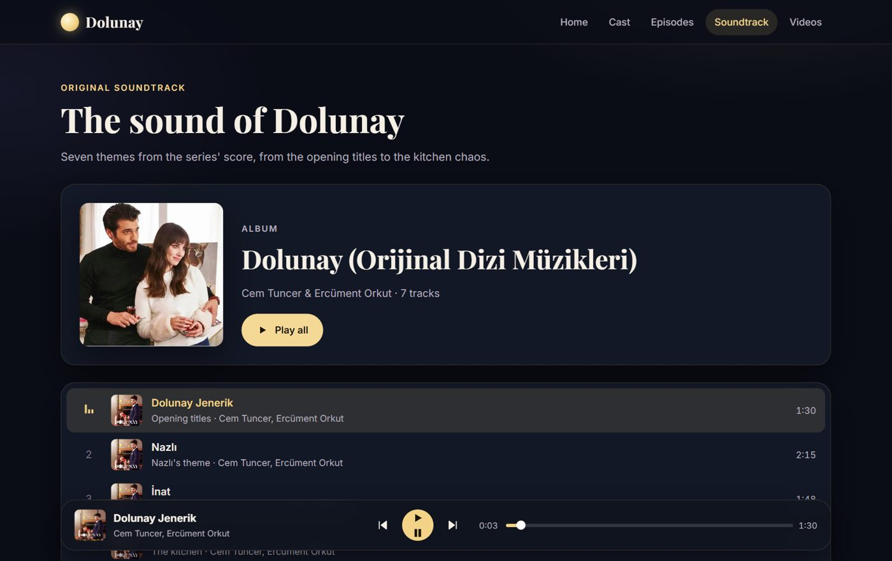
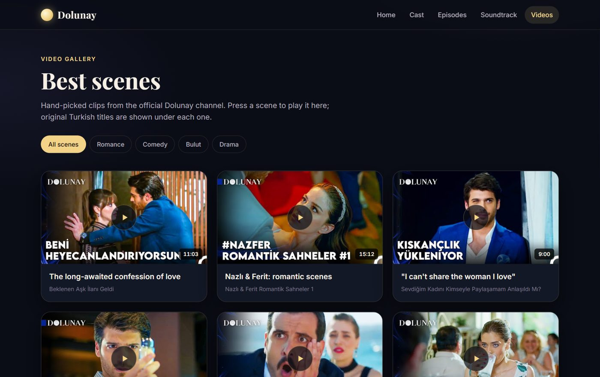

# 🌕 Dolunay (Full Moon): Fan Website

A fan website for **Dolunay** (*Full Moon*), the 2017 Turkish romantic comedy starring **Can Yaman** and **Özge Gürel**. Read the story, meet the cast, track all 26 episodes, listen to the soundtrack and watch the best scenes.

### ▶️ Visit the site: https://sameeha0.github.io/Dolunay-Website-Project/



---

## ✨ Features

| Page | What you can do |
|---|---|
| **Home** | Story, an "At a glance" fact sheet (network, air dates, director, music…), and the official trailer in a pop-up player |
| **Cast** | Six character profiles with the actors who play them, filters (Leads / Family / Friends) and an "Also starring" list of ten more characters |
| **Episodes** | All 26 episodes from the official channel, with search, sort, an **"I've watched this" tracker** with a progress bar, a "Continue with episode N" button and an "Only unwatched" filter (saved in your browser) |
| **Soundtrack** | A custom music player for seven themes from the score: play all, previous / next, seek bar, real track lengths and autoplay of the next song |
| **Videos** | Twelve hand-picked scenes from the official channel, filtered by **Romance, Comedy, Bulut, Drama**, that play right on the page |

**Also:**
- **Responsive design** with a mobile menu; no sideways scrolling on phones
- **Accessible:** skip link, keyboard-friendly controls, visible focus rings, the native `<dialog>` element for video (Escape and the backdrop close it), labelled buttons and alt text
- **Motion with a purpose:** buttons scale slightly when pressed, short ease-out transitions, no constant animation, and everything turns off with *Reduce motion*
- **Privacy-friendly embeds** through `youtube-nocookie.com`; videos stop when the player closes
- **Custom 404 page** and a full-moon favicon

| Cast | Episodes |
|---|---|
|  |  |

| Soundtrack | Videos |
|---|---|
|  |  |

---

## 🔧 What was fixed in the latest update

- **Soundtrack:** all seven songs and the album art used paths starting with `/`, which break on GitHub Pages because the site lives in a sub-folder. They now use relative paths.
- **Home page background:** the CSS pointed to `images/bg.jpg` from inside the `styles/` folder, so the image never loaded. It now uses `../images/bg.jpg`.
- **Dead videos:** 21 YouTube videos had been made private (episodes 1–2 and every clip in the old video gallery). The episodes now link to the official channel's remastered uploads, and the gallery has new clips from the official channel.
- **Trailer:** the Dailymotion player was refusing to load; the trailer now plays from the official channel.
- **Cast page error:** the page loaded the home page's trailer script and crashed; every page now has its own script.
- **Episode count:** the series has 26 episodes, not 27.
- **File names:** images and songs were renamed to plain ASCII (for example `Hayatı Sev.mp3` → `hayati-sev.mp3`) so Turkish letters and spaces can never break a link.
- **Smaller fixes:** a stray `\` on the video page, the sort menu, a missing viewport tag, a Font Awesome icon without its stylesheet, and the wrong clone URL in this README.

---

## 🚀 Run it locally

It's a static site, so no build step is needed.

```bash
git clone https://github.com/Sameeha0/Dolunay-Website-Project.git
cd Dolunay-Website-Project
python -m http.server 8000
# open http://localhost:8000
```

Opening `index.html` directly also works, but a local server is closer to how GitHub Pages serves the site.

---

## 🗂️ Project structure

```
├── index.html          # Home: story, facts, trailer
├── cast.html           # Characters and actors
├── episodes.html       # 26 episodes + watched tracker
├── playlists.html      # Soundtrack player
├── videogallery.html   # Best scenes
├── 404.html            # Custom "page not found"
├── styles/site.css     # One stylesheet for every page (design tokens at the top)
├── javascript/
│   ├── site.js         # Mobile menu + shared video player dialog
│   ├── cast.js         # Cast filters
│   ├── episodes.js     # Episode data, search, sort, tracker
│   ├── soundtrack.js   # Music player
│   └── gallery.js      # Video data and filters
├── images/             # Poster, background, cast photos
├── audios/             # Soundtrack (MP3)
└── docs/               # README screenshots
```

---

## 🛠️ Built with

- **HTML5**: semantic pages, `<dialog>`, `<audio>`
- **CSS3**: custom properties, Grid, Flexbox, `@starting-style`, `prefers-reduced-motion`
- **Vanilla JavaScript**: no frameworks; `localStorage` for the episode tracker
- **Google Fonts**: Playfair Display and Inter

---

## 📚 Sources and credits

- Series facts and cast: [Wikipedia, *Dolunay (TV series)*](https://en.wikipedia.org/wiki/Dolunay_(TV_series))
- Episodes, trailer and scenes: the official [Dolunay YouTube channel](https://www.youtube.com/@Dolunay)
- Soundtrack: *Dolunay (Orijinal Dizi Müzikleri)* by Cem Tuncer and Ercüment Orkut

This is a non-commercial fan project and is not affiliated with the producers or Star TV. All images, video and music belong to their respective owners.

---

Made with 🌕 by **Sameeha**
